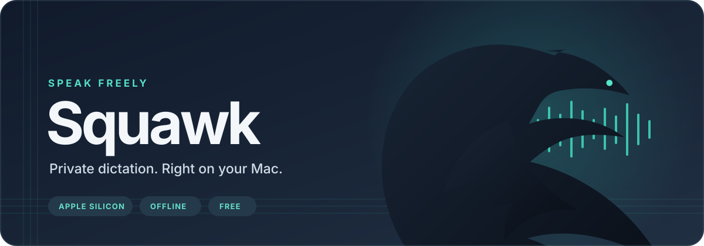
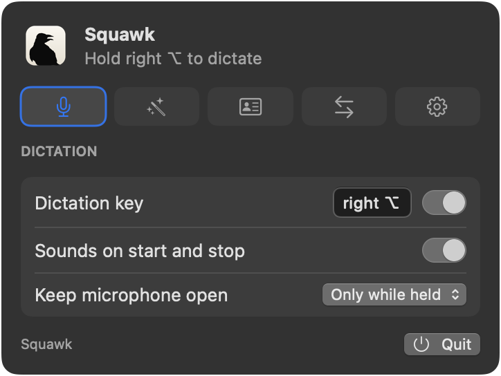
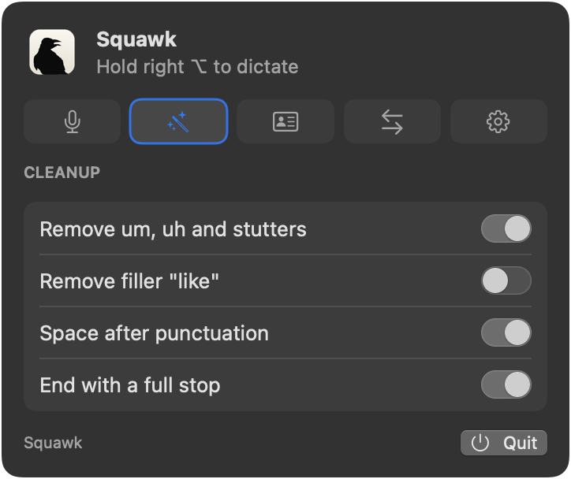
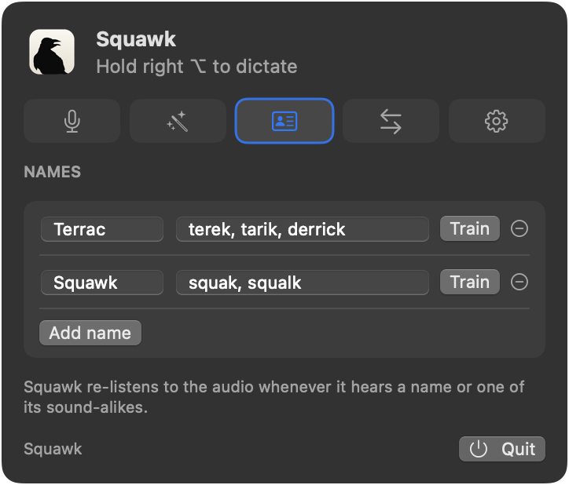
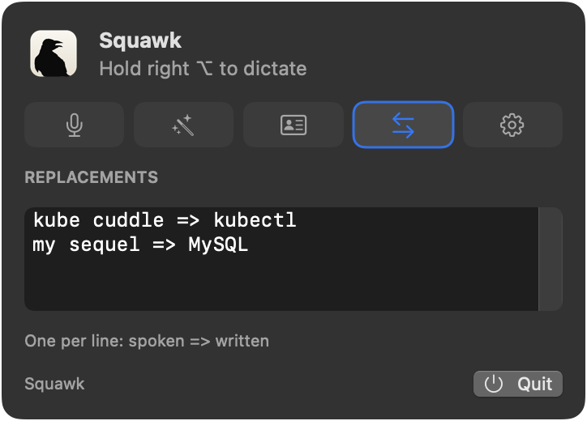
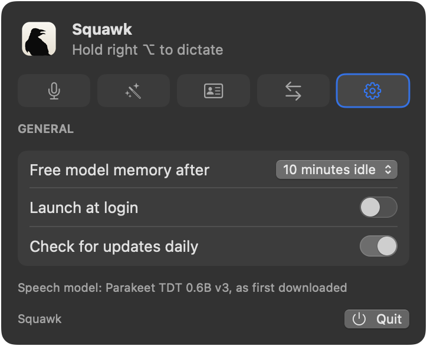
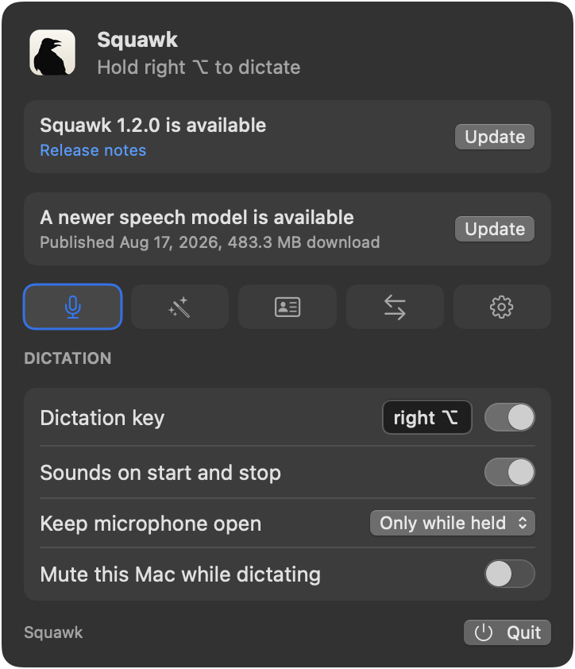

# Squawk

Hold a key, talk, let go, and the words land wherever your cursor is. Squawk is
a free dictation app for Apple Silicon Macs. It runs NVIDIA's Parakeet speech
model on the Neural Engine, and nothing you say or type leaves the machine.

## Purpose

Squawk does one job: turn speech into text in whatever app you are typing in.
You hold the dictation key (Right Option by default) and speak, and when you
release it the text is pasted at the cursor. Double-tap the key to lock
recording hands-free and tap once more to stop. If you press another key while
holding it, Squawk assumes you meant a keyboard shortcut and throws the
recording away.

What gets pasted is what you said, minus the noise. Um and uh are removed,
stuttered words collapse, spacing after punctuation is fixed, and a dictation
that ends without punctuation gets a full stop. An optional setting drops
filler "like" and turns "she was like," into "she said,". You can add
`spoken => written` replacements for jargon. None of this rephrases you: there
is no language model rewriting sentences, only rules that each need a clear
signal before they fire.

Names get their own treatment, because that is where recognition fails most.
You list a name with the spellings it tends to come out as ("Terrac", sounds
like "terek, tarik"), or click Train and say it. From then on, when a
transcript contains something resembling the name, a second small model
re-listens to that stretch of audio and decides between the two. A real Derek
or a real terrace stays as it is.

## Why it exists

The paid apps in this space transcribe well, and several of them use the same
Parakeet model Squawk does. The trouble is everything built around the
transcription: meeting notes, command modes, AI rewriting, accounts, sync,
and in the case of the app Squawk was benchmarked against, an Electron shell
that carries a whole browser in memory to show a small settings screen.

I was happy with the transcription quality and unhappy with paying for, and
giving RAM to, features I did not use. Squawk keeps the part that works and
stops there. It is free, the source is open, and it will stay a dictation app.

## Design

Squawk is a native Swift app with no Electron and no web view. It lives in the
menu bar as a crow icon; clicking it opens the one panel that holds the status,
the on/off switch and every setting. There is no dock icon and no other window.
While you hold the key a small orange level meter appears at the top of the
screen so you can see it is hearing you, and it disappears on release.

The panel has five panes, switched with the row of icons under the header.

| Dictation | Cleanup |
| --- | --- |
|  |  |

| Names | Replacements |
| --- | --- |
|  |  |

| General | With updates waiting |
| --- | --- |
|  |  |

The screenshots are drawn by the app itself from sample data
(`scripts/screenshots.sh`), so they show the real panel and nobody's settings.

Speech recognition is Parakeet TDT 0.6B v3, run through
[FluidAudio](https://github.com/FluidInference/FluidAudio) as CoreML models.
The encoder runs on the Neural Engine, which is why it is fast on a laptop
without making the fans spin: on an M1 Max a dictation is loaded and
transcribed in about a third of a second.

Memory was the main design constraint, since the target is low-spec Apple
Silicon Macs. Measured on an M1 Max running macOS 15.5, the app's own
footprint with the model loaded is 26 MB. The model weights add about 470 MB,
but they are mapped from disk as read-only pages, so macOS can drop them under
memory pressure without swapping, and Squawk unloads the model itself after ten
idle minutes (configurable). The app is 20 MB on disk and the download is
10 MB.

Four details cost some effort and are worth knowing about.

Building an audio engine and opening the microphone took 350 to 450 ms, long
enough to swallow your first word. Squawk now builds the engine ahead of time
and keeps it stopped, so a key press only has to start it, which takes about
150 ms. By default the microphone is open only while the key is held, so the
macOS microphone indicator is on only while you dictate. If the first syllable
still gets clipped, "Keep microphone open" can be set to 30 seconds after each
dictation or to always; Squawk then starts each recording a third of a second
in the past, from a small buffer in memory that is constantly overwritten.

People release the key while the last word is still coming out, and audio cut
mid-word makes the model return nothing. So recording runs on after release
until your voice goes quiet, between 150 and 600 ms.

A microphone hears the room, including whatever the Mac itself is playing, and
a video's dialogue will be transcribed along with your voice. "Mute this Mac
while dictating" silences the output while the key is held; playback carries
on, you just do not hear it for a moment. macOS's echo cancellation was tried
first and dropped: it took about 1.5 s to start on each dictation and made
playback in other apps stutter. With headphones none of this arises.

Text is inserted by putting it on the clipboard and sending Cmd+V, then
restoring what was on the clipboard before. That works in nearly every app,
including terminals, at the cost of briefly using your clipboard. The entry is
marked transient so clipboard managers that honour that marker ignore it.

## Requirements

An Apple Silicon Mac running macOS 14 (Sonoma) or later, and about 600 MB of
free disk for the models.

macOS asks for two permissions on first launch. Microphone is for hearing you.
Accessibility is for watching the dictation key anywhere in the system and for
sending the paste; without it Squawk cannot see the key at all.

The first launch needs a network connection once, to download the speech model
(about 470 MB). Adding your first name downloads a second, 100 MB model. The
first launch of each new version also spends about half a minute compiling the
model for the Neural Engine, shown as "Preparing speech model".

## Compatibility

Apple Silicon only. There is no Intel build and there will not be one, since
the design depends on the Neural Engine.

It has been tested on one machine so far: an M1 Max on macOS 15.5. Other
Apple Silicon Macs on macOS 14 or later should work, but that is expectation,
not measurement, and reports from 8 GB machines are especially welcome.

The model covers 25 European languages, including English, Spanish, French,
German, Italian, Portuguese, Polish, Russian and Ukrainian, and picks the
language from the audio. The cleanup rules (fillers, "like", stutters) are
written for English and do nothing useful in other languages; they can be
switched off.

The dictation key can be one modifier, several held together, or modifiers
plus an ordinary key. Left and right modifiers count as different keys. A bare
letter is refused, since it would stop you typing that letter; F-keys are fine
on their own.

Bluetooth headsets drop to call-quality audio whenever a microphone is open.
With the default "Only while held" that lasts only as long as a dictation; the
other microphone settings hold a headset in call quality for longer.

## Privacy and data use

Audio is captured to memory, transcribed on your Mac, and discarded. It is
never written to disk and never sent anywhere. The transcript goes to the app
you are typing in and nowhere else; Squawk keeps no history. Its log records
sizes and state changes ("recorded 19200 samples", "transcribed 17
characters"), never what was said.

There are no accounts, no analytics, no telemetry and no crash reporting.

Squawk makes exactly four kinds of network request, none of which carries
anything about you, your Mac or your speech:

1. A one-time download of the speech model from Hugging Face on first launch.
2. A one-time download of the name-correction model from Hugging Face, the
   first time you add a name.
3. A daily check of this repository's public releases feed on GitHub, to see
   whether a newer version exists.
4. A daily check of the speech model's public repository on Hugging Face, to
   see whether newer weights exist.

The two daily checks share one switch in the panel under General.

Hugging Face and GitHub see your IP address when those requests are made, as
any web server does. Once the models are on disk Squawk runs with FluidAudio's
offline mode on and works with no network at all.

Your settings, names and replacements are stored in macOS user defaults on
your Mac. The models are stored in
`~/Library/Application Support/FluidAudio/Models`.

When an update is available, an orange dot appears beside the crow and the
panel offers to install it. Squawk downloads the DMG from this repository's
releases and installs it only if the app inside is signed by the same
Developer ID team as the copy you are running. A download that fails that check
is not installed.

The speech model updates separately from the app. When the weights Squawk uses
change upstream, the panel offers the new model with its own Update button.
Squawk downloads it into its own folder
(`~/Library/Application Support/Squawk/Models`), has it transcribe a test
sentence, and switches to it only if that works; the app itself is not replaced
and dictation keeps working on the old model in the meantime. Commits upstream
that do not change the files Squawk loads, such as README edits, are not
offered. Unlike an app update, a model is not code-signed: installing one
trusts the FluidInference account on Hugging Face, which is the same trust the
first download already places in it.

## Licensing

Squawk's own code is licensed under GPL-3.0; see `LICENSE`. You can use it,
study it, change it and share it, and anything you distribute that is built
from it has to be offered under the same terms. The crow artwork is part of
this repository and covered by the same licence.

It depends on two things with their own licences.

[FluidAudio](https://github.com/FluidInference/FluidAudio), the Swift library
that runs the models, is Apache-2.0.

The speech model is NVIDIA's
[Parakeet TDT 0.6B v3](https://huggingface.co/nvidia/parakeet-tdt-0.6b-v3),
licensed under [CC-BY-4.0](https://creativecommons.org/licenses/by/4.0/),
which permits commercial and non-commercial use with attribution. The
name-correction model is derived from NVIDIA's
[Parakeet TDT-CTC 110M](https://huggingface.co/nvidia/parakeet-tdt_ctc-110m).
Squawk uses the CoreML conversions of both published by FluidInference
([parakeet-tdt-0.6b-v3-coreml](https://huggingface.co/FluidInference/parakeet-tdt-0.6b-v3-coreml),
[parakeet-ctc-110m-coreml](https://huggingface.co/FluidInference/parakeet-ctc-110m-coreml)),
which are tagged CC-BY-4.0 on Hugging Face; the conversion scripts are in
[FluidInference/mobius](https://github.com/FluidInference/mobius). The models
are downloaded to your Mac on first use and are not part of this repository or
of the Squawk download.

## Installing

Download the DMG from the
[releases page](https://github.com/bluefishforsale/squawk/releases), drag
Squawk to Applications, and open it. Releases are signed with a Developer ID
and notarized by Apple.

## Building from source

The command line tools and a Swift 6 toolchain are enough; Xcode is not
required.

    swift test
    scripts/bundle.sh
    open dist/Squawk.app

`scripts/bundle.sh` signs with the first Developer ID in your keychain, and
falls back to an ad-hoc signature when there is none. The difference matters:
macOS remembers the Accessibility and Microphone grants against the signing
identity, so a Developer ID build keeps them across rebuilds and an ad-hoc
build loses them every time. Local builds are version 0.0.0 and never check
for updates.

To run a file through the same model path without the UI, which is handy for
checking memory and speed:

    /usr/bin/time -l dist/Squawk.app/Contents/MacOS/Squawk --transcribe sample.wav
    dist/Squawk.app/Contents/MacOS/Squawk --transcribe sample.wav --name "Terrac=terek,tarik"

## Releasing

Pushing a `v*` tag runs `.github/workflows/release.yml`, which builds the app
in a job with no secrets, then signs, notarizes and staples it in the `release`
environment and publishes the DMG. Only `v*` tags can deploy to that
environment. It needs `APPLE_CERTIFICATE`, `APPLE_CERTIFICATE_PASSWORD`,
`APPLE_SIGNING_IDENTITY`, `APPLE_TEAM_ID`, `APPLE_API_ISSUER`, `APPLE_API_KEY`,
`APPLE_API_PRIVATE_KEY` and a random `KEYCHAIN_PASSWORD` there. A tag pushed
while any is missing fails at the first job, before anything is built.

Pull request builds are ad-hoc signed and are for testing only.
